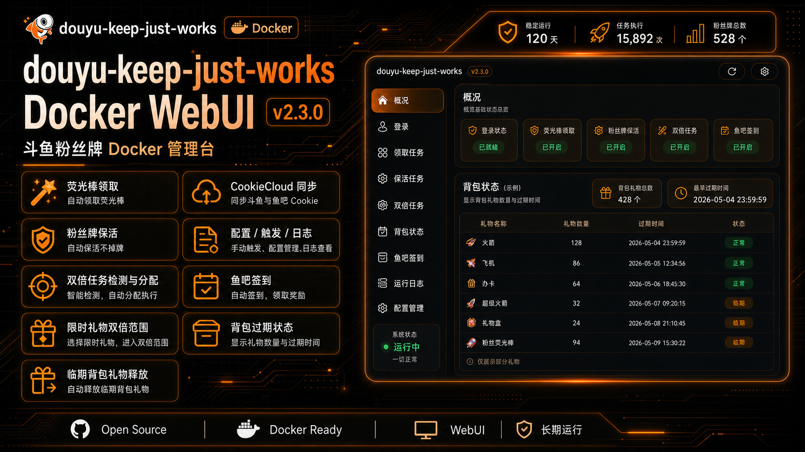

<div align="center">
  
  <h1>douyu-keep-just-works</h1>
  <p><strong>斗鱼粉丝牌 Docker 管理台</strong></p>
  <p>扫码登录、粉丝牌保活、双倍任务检测、临期礼物处理和鱼吧签到，适合 NAS / 家庭服务器长期后台运行。</p>

  <p>
    <a href="https://hub.docker.com/r/tophtab/douyu-keep-just-works"></a>
    <a href="https://hub.docker.com/r/tophtab/douyu-keep-just-works/tags"></a>
    <a href="https://github.com/tophtab/douyu-keep-just-works/releases"></a>
    <a href="./LICENSE"></a>
  </p>

  <p>
    <a href="#快速部署">快速部署</a> ·
    <a href="#功能一览">功能一览</a> ·
    <a href="#配置建议">配置建议</a> ·
    <a href="#声明">声明</a>
  </p>

  
</div>

## 快速部署

默认部署使用 GitHub Workflow 发布到 Docker Hub 的镜像。

```yaml
services:
  douyu-keep-just-works:
    image: ${DOCKER_IMAGE:-tophtab/douyu-keep-just-works}:${DOCKER_TAG:-latest}
    container_name: douyu-keep-just-works
    restart: unless-stopped
    ports:
      - '51417:51417'
    volumes:
      - ./config:/app/config
    environment:
      - TZ=Asia/Shanghai
      - WEB_PASSWORD=password
```

### 飞牛 fnOS

推送 `vX.Y.Z` 或 `VX.Y.Z` tag 后，发布 Workflow 会先生成同版本的
amd64/arm64 Docker 镜像，再自动构建飞牛安装包并上传到该 tag 对应的
[GitHub Release](https://github.com/tophtab/douyu-keep-just-works/releases)。下载
`douyu-keep-just-works-X.Y.Z-fnos.fpk` 后，可在飞牛 fnOS 应用中心手动安装；
安装包会持久化应用配置，并在桌面提供 WebUI 入口。

当前安装包沿用 Docker 版本的默认 WebUI 密码 `password`。首次登录后请避免将
服务直接暴露到公网；安装包暂不提供修改容器环境变量的安装向导。

## 功能一览

| 功能 | 用途 |
| --- | --- |
| 扫码登录 | 通过斗鱼 passport 二维码创建本项目自己的本地登录快照 |
| 荧光棒领取 | 自动领取荧光棒 |
| 粉丝牌保活 | 定时执行保活任务，降低粉丝牌掉牌风险 |
| 双倍任务 | 检测双倍亲密度任务并分配执行 |
| 临期礼物 | 自动赠送临期荧光棒 |
| 鱼吧签到 | 自动执行鱼吧签到 |
| WebUI 管理 | 查看状态、修改配置、查看日志、手动触发任务 |
| CookieCloud | 可作为浏览器 Cookie 同步兼容路径 |

## 推送通知（MagicPush）

WebUI 新增「推送设置」页，把任务执行情况推送到飞书群，无需在容器里配置飞书应用凭据。

| 推送场景 | 行为 |
| --- | --- |
| 定时任务到点执行 | 不推送，只记录，进入每日汇总 |
| 手动触发任务 | 立即推送单次结果（耗时、结果、最近日志） |
| 每日汇总 | 每天固定时间推送一张卡片，列出所有已启用任务的执行情况 + 当前 Cookie 状态 |
| 登录类事件 | 未登录 / 扫码成功时即时推送 |

卡片使用斗鱼橙主题（`#FF5D23` 色系）。推送走自建 [MagicPush](https://github.com/magiccode1412/MagicPush) 网关的 `POST /api/push/<token>`，飞书卡片通过 `extraData.feishu.channelType=interactive_card` 投递，被拒收时自动降级为 markdown 文本。

渠道配置有两种方式，界面配置优先于环境变量：

- WebUI「推送设置 → 推送渠道」：网关地址、Endpoint 令牌、消息格式（卡片 / Markdown），可一键发送测试消息
- 环境变量：`MAGICPUSH_URL`、`MAGICPUSH_TOKEN`

> 令牌保存在 `config/config.json` 内（该目录已被 `.gitignore` 排除）。`GET /api/push-report` 只返回掩码预览，不会回传明文；保存时令牌留空表示不修改。

## 修改 WebUI 密码

「账号安全」页可直接修改登录密码，无需重建容器：

- 首次启动沿用环境变量 `WEB_PASSWORD`；修改后写入 `config/auth.json`（`0600`，scrypt 加盐哈希，不存明文），并**优先生效**，环境变量里的旧值不再使用
- 修改成功后其他设备的会话立即失效，当前浏览器自动换新会话
- 登录接口带简单防爆破：同 IP 5 分钟内失败 5 次锁定 60 秒
- 忘记密码时删除 `config/auth.json` 并重启容器，即回退到 `WEB_PASSWORD`

## 配置建议

- 推荐优先使用登录页的“扫码登录”。它会通过斗鱼 passport 二维码创建本项目自己的本地登录快照，并按 passport -> 主站 -> 鱼吧的顺序保存。
- CookieCloud 仍可作为浏览器同步兼容路径。它只会把浏览器 Cookie 拉取为本地登录快照；项目不会把刷新后的 Cookie 写回浏览器或 CookieCloud。
- CookieCloud 同步不会用不完整的浏览器快照覆盖已经完整的本地主站或鱼吧快照，除非你手动保存新的 Cookie。
- 手填 Cookie 只作为兜底，适合临时修复登录态或保存独立的 passport Cookie。
- 建议把 `WEB_PASSWORD` 改成只有自己知道的值，并避免把 `config.json`、Cookie、CookieCloud 密码或 WebUI 密码贴到公开 issue。

## 理念：it just works

纯 vibe coding，能用就行。（出自 Todd Howard 超级小陶）

## 声明

本项目仅供个人学习、技术研究与非商业性技术交流使用，仅提供代码与部署方式参考。

使用者应自行确认其使用行为符合目标平台规则及当地法律法规，作者不对因使用本项目产生的任何直接或间接后果负责。

## 致谢

本项目最初基于 Curtion 的相关实现演进而来，感谢原项目提供的思路与基础：

- [Curtion/douyu-keep](https://github.com/Curtion/douyu-keep)
- [qianfeiqianlan/yuba-check-in](https://github.com/qianfeiqianlan/yuba-check-in)
- [qianjiachun/douyuEx](https://github.com/qianjiachun/douyuEx)
- [starudream/sign-task](https://github.com/starudream/sign-task)
- [每日荧光棒领取的非浏览器模拟方案](https://nicelee.top/blog/2021/09/28/python-douyu-danmu/)
- [LINUX DO 社区](https://linux.do/)
- 给 AI 立规矩的开源框架：[trellis](https://github.com/mindfold-ai/Trellis)
